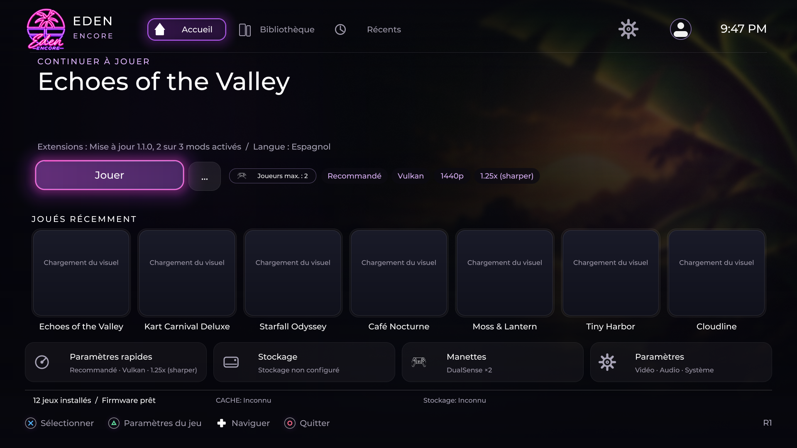

  

  <h1>Prospero.Eden Encore</h1>

  <h3>L'émulation native, pensée pour jouer depuis son canapé.</h3>

  
<strong>Un fork d'émulateur natif PS5 pour le firmware 13.60 : chargeurs NSP, XCI, NSZ, XCZ, NRO, NSO, NCA, NAX et KIP, décompression LZ4 + ZBIC/zstd, interface TV et compilation reproductible.</strong>

  
<a href="README.md"><strong>English</strong></a> · <strong>Français</strong>

  
<kbd>Firmware 13.60 · testé sur matériel</kbd> <kbd>Vulkan + OpenGL</kbd> <kbd>Interface TV</kbd> <kbd>Dynarmic</kbd>

  

    <a href="#-pourquoi-encore-"><strong>Avantages</strong></a> ·
    <a href="#-installation"><strong>Installation</strong></a> ·
    <a href="#-compatibilité-et-limites"><strong>Compatibilité</strong></a> ·
    <a href="#-compilations-et-validations"><strong>Builds</strong></a> ·
    <a href="README.md#credits"><strong>Crédits</strong></a>
  

> [!IMPORTANT]
> **FC27 — tableau maître :** [priorités F07 P0/P1/P2, sparse JIT et validation matérielle](docs/FC27_F07_MASTER_TRACKER.md). Les [critères F01–F06 validés sur hôte](docs/FC27_EXIT_GATES_2026-10-22.md) ne prouvent pas la jouabilité sur console. Le nombre de sources examinées ne mesure pas les optimisations restantes.
>
> **Le firmware 13.60 est notre cible principale testée sur console.** Cela ne garantit ni le fonctionnement de tous les jeux, ni la compatibilité d'autres versions système. Le launcher et certains jeux ont été exécutés sur cette version ; les saccades, la progression en fin de match et certains contrôles personnalisés restent à résoudre.
>
> **Avant un test console :** [audit des logs, mises à jour, build et fichiers à conserver](docs/PRETEST_AUDIT_2026-10-14.md). Vérifier le SHA exact du paquet et des symboles.

---

## ✨ Pourquoi Encore ?

Une bonne expérience d'émulation ne se résume pas à lancer un jeu. Il faut pouvoir naviguer depuis la télévision, comprendre ses réglages, retrouver ses données et identifier précisément les problèmes.

| | Ce qu'apporte Encore |
| --- | --- |
| **🎮 Interface TV** | Accueil néon tropical, jeux récents, visuels, bibliothèque et navigation manette. |
| **🧩 Fichiers et compression** | Sélection NSP, XCI, NSZ, XCZ, NRO, NSO, NCA, NAX, KIP ; décodage LZ4 et ZBIC/zstd. Certains fichiers ne démarrent qu'avec des contenus supplémentaires. |
| **🛟 Mode récupération** | Safe Launch temporaire, remises à zéro confirmées et migration sécurisée. |
| **⚙️ Profils par jeu** | **Minimum, Recommandé, Haute, Ultra**, puis **Personnalisé** en cas de modification. |
| **🎨 Graphismes natifs** | Vulkan/RADV et OpenGL, filtres, mise à l'échelle, anticrénelage et caches. |
| **🔎 Diagnostics** | Mesures CPU/JIT, frames lentes, mémoire, verrous et services invités, au-delà du simple compteur FPS. |
| **🔐 Intégration maîtrisée** | Sources épinglées, vérification des archives compilées et précautions d'accès aux fichiers. |

<strong>Qu'est-ce qui change par rapport au projet d'origine ?</strong>

 

| Domaine | Évolution Encore |
| --- | --- |
| **Firmware** | Qualification prioritaire sur **13.60**, sans extrapolation aux autres versions |
| **Interface** | Accueil, bibliothèque, récents et paramètres rapides repensés pour la TV |
| **Chargement** | NSP, XCI, NSZ, XCZ, NRO, NSO, NCA, NAX, KIP ; LZ4 + ZBIC/zstd |
| **Récupération** | Safe Launch sur une seule session, sans écraser les préférences enregistrées |
| **Stockage** | Même structure de dossiers sur stockage interne ou externe ; migration prudente |
| **Manette** | Profils du launcher et réglages personnels ; actions enregistrées en jeu encore à qualifier |
| **Graphismes** | Adaptations GPU vérifiées du code source jusqu'à l'archive native |
| **Qualité** | Tests hôtes, compilation native et validation sur console clairement distingués |

Encore reste un fork communautaire indépendant, et non une version officielle des projets amont.

---

## 📦 Formats de jeux et compression

| Catégorie | Formats | Portée actuelle |
| --- | --- | --- |
| Jeux dans la bibliothèque | **NSP** (`.nsp`), **XCI** (`.xci`) | Détection et lancement déjà présents |
| Jeux compressés | **NSZ** (`.nsz`), **XCZ** (`.xcz`) | Lecteur NCZ expérimental, jeux, mises à jour et DLC ; compilation native et console encore à qualifier |
| Compression interne des exécutables | **LZ4**, **ZBIC / zstd** | Décompression des segments NSO ; **ce ne sont pas des extensions de jeux** |
| Fichiers chargeables directement | **NRO, NSO, NCA, NAX, KIP** | Sélectionnables ; le démarrage dépend des données complètes et compatibles. |

**Les dossiers ExeFS décompressés** sont également détectés lorsque `roms/<titre>/` contient les fichiers réguliers `main` et `main.npdm`, sans liens symboliques. Ils apparaissent sous `EXEFS` dans la bibliothèque ; c'est un agencement de dossier, pas une extension supplémentaire.

La compression NCZ par blocs se lit directement. Un fichier « solid » peut être décompressé temporairement dans `/data/prosperoeden/user/cache/nsz/`, ce qui nécessite de l'espace pour sa taille décompressée. La lecture des métadonnées hors jeu conserve des fragments vérifiés et bornés. Il s'agit d'un support en développement, **pas encore d'une version qualifiée sur console**.

[Guide de stockage et des fichiers compressés](INSTALL.md#compressed-nsz-and-xcz-games) · [Lecteur et tests](headless/ncz.h) · [Matrice complète des formats](docs/CONTENT_FORMAT_MATRIX_2026-10-23.md)

---

## 🚀 Installation

> [!TIP]
> Pour une version publiée et qualifiée, commence par [les releases GitHub](https://github.com/niakw/Prospero.Eden-Encore/releases). Les artefacts d'une CI verte sont des **versions de développement**, pas une garantie de fonctionnement en match.

Le paquet ZIP contient le dossier natif `PPSA99008/`. Une image FFPFSC peut également être proposée selon la release.

**Installation du dossier :** `/data/homebrew/PPSA99008/`.

**Stockage persistant par défaut :** `/data/prosperoeden/` avec `keys/`, `firmware/`, `roms/`, `updates/`, `mods/`, `save-import/` et `save-export/`.

Avec un disque externe, seule la racine change : les sous-dossiers restent identiques. **Ne supprime pas les anciennes données persistantes avant une migration**. Aucun jeu, clé, firmware propriétaire ou DLC n'est fourni.

**Guide complet :** [INSTALL.md](INSTALL.md) · [Compiler Encore](docs/BUILDING.md) · [Aide](SUPPORT.md).

---

## 🎛️ Réglages et navigation

| Fonction | Description |
| --- | --- |
| **Accueil, Bibliothèque, Récents** | Navigation à la manette et métadonnées des jeux, avec repli hors ligne |
| **Lancement animé** | Véritable boîtier 3D : chaque scan recto/verso disponible reste prioritaire ; à défaut, reconstruction native avec artworks, captures distinctes, titre et descriptif, sans génération d'image. [Détails](docs/LAUNCH_CASE_ARTWORK.md) |
| **Paramètres rapides** | Ajustements vidéo et préférences par titre |
| **Profils vidéo** | **Minimum → Recommandé → Haute → Ultra**, puis **Personnalisé** |
| **Safe Launch** | Pour une seule session : OpenGL, 1×, 1080p, bilinéaire, portable, 60 Hz, mods désactivés |
| **Manettes** | Profils du launcher, vibrations, zones mortes et préférences |
| **Langues** | Catalogues de l'interface pour **29 langues** |
| **Image** | Définition, filtrage, mise à l'échelle, netteté et anticrénelage |

Le mapping physique du launcher et la configuration des actions mémorisée **à l'intérieur d'un jeu** sont deux mécanismes distincts. Le bon chargement des actions personnalisées pendant le match n'est pas encore démontré.

<strong>Architecture : CPU, JIT, Vulkan et mémoire</strong>

- **Dynarmic reste le JIT de référence.** Le JIT partagé et certaines compilations anticipées ne sont pas activés aveuglément.
- **Vulkan/RADV et OpenGL** sont deux chemins natifs. Les adaptations GPU sont vérifiées contre les sources et l'archive produite.
- **Cache shaders :** une taille de cache configurée ne démontre pas que les shaders sont réellement réutilisés.
- **Mémoire :** déclaration du paquet, mémoire invitée, tables clairsemées et cache JIT ne désignent pas la même ressource. L'unique profil PS5 intègre désormais un JIT sparse RX/RW avec engagement physique à la demande et libération après invalidation complète et quiescente. Ce comportement est testé sur hôte, mais ses économies et sa stabilité sur firmware 13.60 restent à qualifier.
- **Performances :** les fenêtres de télémétrie, verrous et IPC doivent expliquer les ralentissements et les gels, pas simplement afficher des FPS.

[Architecture](docs/PS5_NATIVE_ARCHITECTURE.md) · [Feuille de route performance](docs/PERFORMANCE_ROADMAP.md) · [Audit des adaptations](docs/INTEGRATION_AUDIT_CPU_GPU_JIT_2026-10-14.md)

---

## 🧪 Compatibilité et limites

| Cas | État vérifié |
| --- | --- |
| **Firmware 13.60** | Cible matérielle testée : launcher et sessions sur certains jeux |
| Autres firmwares | **Non qualifiés** |
| Chargement NSO ZBIC/zstd et LZ4 | Implémenté ; dépend du logiciel |
| Match complet du jeu de référence | **Saccades et gel final toujours ouverts** |
| Contrôles personnalisés en match | **Application des actions du jeu non encore démontrée** |
| HUD en jeu | Fraîcheur des images et des données toujours étudiée |

Sur le dernier match intégral archivé (`2efd8b3c`), nous avons mesuré **858 images à plus de 50 ms**, dont **10 au-delà de 500 ms**, ainsi qu'une longue période durant laquelle la présentation continue sans progression normale des services du jeu. Des correctifs plus récents compilent, mais **aucun nouveau test sur console ne prouve encore un gain de fluidité ou la disparition du freeze**.

[Rapport de simulations et logs](docs/FC27_STRESS_REPLAY_2026-10-14.md) · [Plan de résolution](docs/GAMEPLAY_FREEZE_RECOVERY_PLAN.md)

---

## 📦 Compilations et validations

**Branche unique de développement : `dev/ps5-sparse-jit`.**

1. **Tests source/hôtes :** contrôlent le code, les adaptations, la mémoire, les entrées et les régressions.
2. **Compilation native :** vérifie les exécutables et le contenu réel de l'archive téléchargeable.
3. **Console :** valide ensuite le lancement, la réactivité, la qualité d'image, les commandes et la progression du jeu.

[Tests du code](https://github.com/niakw/Prospero.Eden-Encore/actions/workflows/encore-core-preflight.yml?query=branch%3Adev%2Fps5-sparse-jit) · [Paquets natifs](https://github.com/niakw/Prospero.Eden-Encore/actions/workflows/build-040-zbic.yml?query=branch%3Adev%2Fps5-sparse-jit)

Ne pas confondre une CI verte avec une version stable ou des performances validées sur la console.

---

## 🛡️ Sécurité, licences et crédits

Encore est un fork communautaire non officiel, distribué sous **GPL-3.0-or-later**. Le durcissement de l'accès aux fichiers n'est **pas** un bac à sable après élévation de privilèges.

**Sources et auteurs :** [crédits détaillés dans le README principal](README.md#credits) · [composants tiers](THIRD_PARTY_NOTICES.md) · [textes complets](LICENSES/).

[Licence](LICENSE) · [Sécurité](SECURITY.md) · [Contribuer](CONTRIBUTING.md) · [Support](SUPPORT.md) · [Code de conduite](CODE_OF_CONDUCT.md).

Ce projet ne distribue aucun jeu commercial, aucune clé, aucun firmware ni aucun contenu propriétaire. Il ne confère aucun droit de redistribution sur les logiciels tiers.
