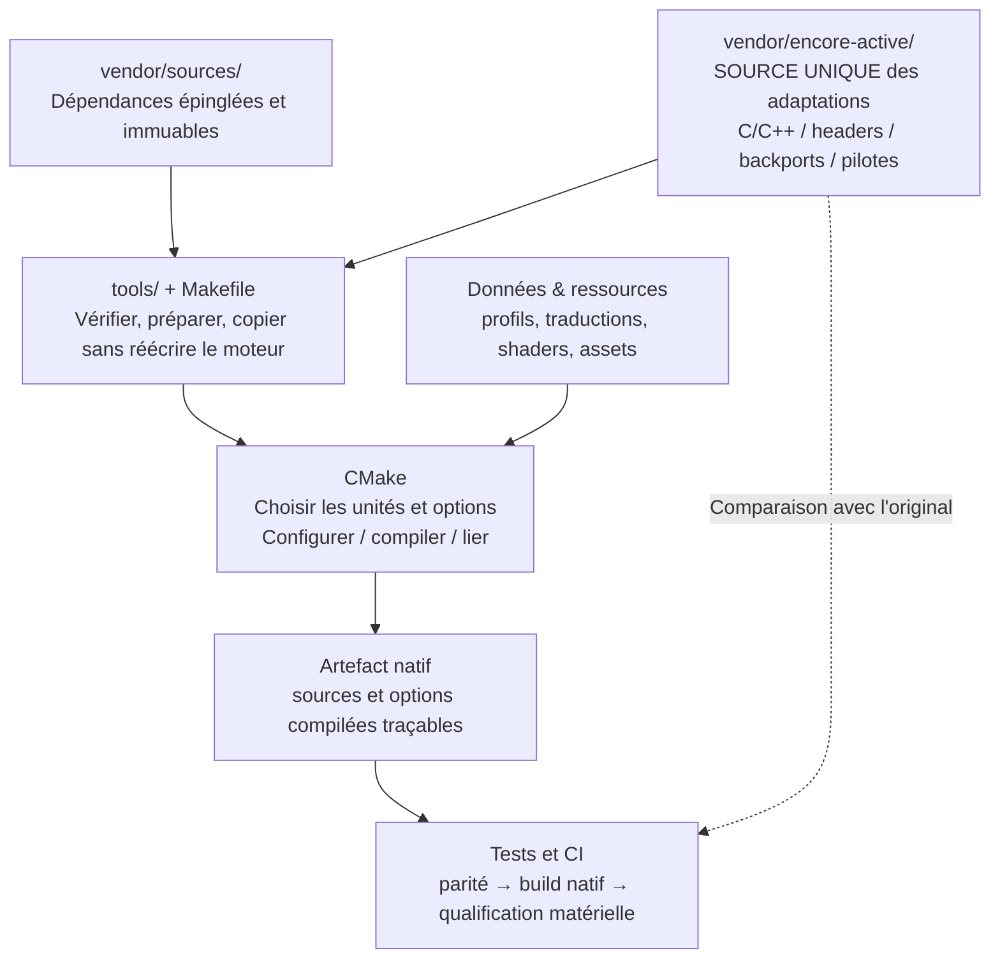

# Eden Encore — architecture du dépôt et contrat de source unique

**Statut : décision d'architecture / cible obligatoire, migration en cours.**
**Référence :** `dev/ps5-sparse-jit`, relevé structurel du 18 octobre 2026.
**Périmètre :** moteur natif, dépendances, JIT, CPU/HLE, mémoire, GPU, backend vidéo, build, scripts et CI. Le launcher reste un chantier fonctionnel distinct.

> **Principe : une modification de code d'une dépendance = une source maintenue dans `vendor/encore-active/` = un seul chemin réellement sélectionné par le compilateur.**
>
> Ce document définit la **cible**, pas un état déjà atteint. Ne jamais assimiler la présence d'un fichier sous `encore-active`, un test hôte vert ou un manifeste à une preuve d'exécution correcte sur console.

## 1. Architecture cible

**Il existe deux catégories différentes d'entrées :**

- **Code tiers adapté :** sa version Encore maintenue est versionnée **exclusivement** sous `vendor/encore-active/`. Le code épinglé reste intact. Les outils ne fabriquent pas un deuxième corps C++.
- **Code propre à l'application, configuration et ressources :** ils peuvent résider dans `headless/`, `src/`, `data/`, `assets/` ou d'autres emplacements identifiés. Un shader, un catalogue de chaînes ou un profil généré n'est pas automatiquement un override de dépendance.

Les fichiers CMake maintenus eux-mêmes peuvent figurer dans `encore-active` lorsque ce sont des **recettes de build versionnées** : ce n'est pas une permission de réintroduire des fonctions C++ sous forme de chaînes dans CMake.

Les volumes changent à chaque migration : les chiffres courants sont dans les registres de sources et de générateurs, pour éviter de figer plusieurs totaux contradictoires dans l'architecture.

## 2. Inventaire récursif des dossiers : rôle et frontière

L'arbre Git a été interrogé pour les **racines du dépôt et leurs sous-arbres**. Cette carte couvre les familles de répertoires, y compris celles qui ne contiennent pas de code C++. Elle ne signifie pas que chaque fonction de chaque dépendance a été relue, ni que les chemins de build ont été prouvés par compilation.

| Famille | Sous-dossiers / contenu recensés | Rôle autorisé | Risque à contrôler |
| --- | --- | --- | --- |
| `.github/` | `workflows/`, `codeql/`, `ISSUE_TEMPLATE/` | CI, analyse, automatisation de tests et packaging | Aucun workflow ne doit créer un correctif C++ hors `encore-active` |
| `assets/` | Artworks / ressources | Ressources applicatives | Aucun code moteur |
| `data/` | Dont `glyph-research/` et données des glyphes | Entrées de contenu et profils | Génération d'en-tête de **données**, pas de fonctions tiers |
| `docs/` | Architecture, audits, migration, catalogues | Contrats et preuves | Ne pas confondre inventaire et validation |
| `fixtures/` | Cas d'essai, fragments de tests | Oracles/tests | Ne doit pas remplacer le code compilé en release |
| `headless/` | `backports/`, `dynarmic/`, `prosperoeden/`, `elevation/`, sources natives, CMake, `.inc` | Application/bridge natif, launcher, sélection de build | **Dette majeure** : générations et injections de C++ |
| `sce_sys/` | Métadonnées de package | Emballage | Pas de modification du moteur |
| `src/` | Petites sources propres au port | Code natif local | Bien distinguer code original et substitution de dépendance |
| `third_party/` | Dont `fonts/` | Bibliothèques/ressources embarquées | Toute adaptation d'une source tierce doit être déclarée |
| `tools/` | `ci/`, `fixtures/`, `launcher/`, `stubs/`, `verify/`, scripts racine | Préparation, copie, génération de **ressources**, vérification | Scripts d'écriture et patches cachés dans le chemin de build |
| `vendor/sources/` | 23 arbres de dépendances épinglées, dont `eden/`, `eden-cpm/`, `ps5-mesa/`, `encore-overrides/`, OpenGL, runtime, SDK | Origines intègres, auditées par révision et empreinte | Ne jamais servir de seconde source modifiée |
| `vendor/objects/` | Objets/chunks et manifestes des dépendances | Cache/versionnement d'objets sources | Pas de correctif C++ actif caché |
| `vendor/encore-active/` | `compiler-rt/`, `eden-backports/`, `eden-build/`, `eden-core/`, `eden-gpu/`, `eden-shader/`, `eden-surface-lifecycle/`, `eden-sync/`, `eden-threading/`, `eden-vulkan/`, `ps5-mesa/` | **Source unique** des adaptations de dépendances | Chaque version doit être réellement sélectionnée, sans remplacement ultérieur |
| Racine | `Makefile`, README, licences, `UPSTREAM.json` et documentation utilisateur | Orchestration et provenance | Pas de correctif du moteur encodé dans la recette |

Les sous-dossiers de `vendor/sources/` restent du **code tiers épinglé**, non des emplacements autorisés pour de nouveaux correctifs Encore. La forêt volumineuse de `eden-cpm/boost` dépasse la limite de réponse récursive de l'API GitHub : sa présence et sa racine ont été vérifiées séparément ; **aucun contrôle exhaustif du contenu de toutes ses fonctions n'est revendiqué**. Les répertoires racine `headless/`, `tools/`, `vendor/encore-active/` et `vendor/objects/` ont été énumérés récursivement sans troncature.

### Cas particuliers à ne pas mélanger

- `vendor/sources/encore-overrides/` : **base épinglée de profils de jeux** ; malgré le terme « overrides », elle n'est pas le stockage des correctifs C++ du moteur. Les en-têtes `headless/encore_overrides_generated.h` et `headless/glyph_overrides_generated.h` en sont des sorties de **données** contrôlées, pas des réécritures C++ du CPU/GPU.
- `headless/prosperoeden/` : code du launcher, thème, UX, traduction. Ne pas déplacer aveuglément ces fichiers sous `vendor/encore-active` ni empiéter sur les travaux UI.
- `headless/backports/` : patches historiques ; ils peuvent rester des **oracles d'équivalence** hors production, mais **pas** constituer une autre implémentation livrée.
- `vendor/encore-active/eden-threading/native-hle-overrides.cmake` : sélecteur de sources maintenues et de headers copiés sans transformation textuelle de fonctions. Ce modèle est acceptable.
- Les tests hôtes qui transforment temporairement un staging (par exemple FFmpeg ou Meson) doivent être identifiés **hôte/configuration**, séparés des mutations de sources effectivement livrées.

## 3. Règles obligatoires, applicables à tout le dépôt

| Élément | Autorisé | Interdit |
| --- | --- | --- |
| `vendor/encore-active/**` | Vrais fichiers C/C++, en-têtes complets, backports matérialisés, CMake de build versionné, driver fork | Plusieurs implémentations actives concurrentes d'une même variante non documentée |
| `vendor/sources/**` | Sources épinglées immuables, identité SHA | Corriger directement la copie de référence versionnée |
| `headless/CMakeLists.txt`, `headless/**/*.cmake` | `target_sources`, `target_include_directories`, `target_compile_definitions`, liaison et options | `file(READ)` + `string(REPLACE)` pour réécrire des fonctions C++ destinées au binaire |
| `headless/**/*.inc` | Fragments applicatifs autonomes, ressources et entrées déclarées | Cacher un patch de dépendance injecté dans une source dérivée |
| `tools/**` | Vérifier SHA, recopier les sources maintenues, préparer SDK/cache, tester, générer des ressources | Reconstruire au build une variante C++ corrigée à partir d'un patch ou de substitutions |
| `.github/**` | Tester les invariants, construire, publier des reçus | Mutation silencieuse du code tiers avant le build |
| `docs/**` | Contrats, statut, sources, preuves, décisions et liens | Afficher « conforme » sans preuves de sélection effective |

**Une exception temporaire n'est pas une norme :** les mécanismes existants sont une **dette explicitement suivie** et ne doivent pas être copiés pour de nouveaux correctifs. Ne pas désactiver brutalement un générateur JIT/mémoire/GPU sans prouver la parité et la sélection équivalente.

### Contrat de sélection

Pour chaque fichier tiers adapté, on doit pouvoir répondre sans ambiguïté :

1. **Provenance :** quel fichier/commit original a été adapté ?
2. **Propriétaire :** quel chemin unique sous `vendor/encore-active/` maintient le correctif ?
3. **Variante :** `PS5_NATIVE`, `EDEN_DEV_PROFILE`, Vulkan/OpenGL, JIT, fastmem, option expérimentale ou release ?
4. **Compilation :** quelle cible, quel `.cpp` ou header et quelles priorités d'inclusion sont réellement actifs ?
5. **Concurrence :** la source précédente a-t-elle été retirée de la cible, sans double compilation ni masquage par un include prioritaire ?
6. **Preuve :** résultat d'un contrôle d'équivalence, d'un build natif et, quand nécessaire, d'un essai console à SHA identique ?

Les variantes volontairement distinctes doivent chacune avoir une **sélection conditionnelle explicite** et un propriétaire documenté. « Un propriétaire » n'interdit pas les variantes contrôlées : cela interdit les réécritures concurrentes et opaques.

## 4. État réel : dette connue, non résolue

**Photographie des registres datés du 17–18 octobre 2026, susceptible de changer entre deux commits :**

- `vendor/encore-active/` : inventaire de sources et fragments maintenus dans [`EDEN_ACTIVE_SOURCE_CATALOG.md`](EDEN_ACTIVE_SOURCE_CATALOG.md) ; la couverture de chemins n'est pas une preuve d'exécution.
- `headless/CMakeLists.txt` : générateurs `write_derived()` restants et positions exactes dans [`EDEN_OVERRIDE_MIGRATION_INVENTORY.md`](EDEN_OVERRIDE_MIGRATION_INVENTORY.md) ; les modules indirects y sont suivis séparément.
- Modules CMake secondaires : **12 appels** supplémentaires, soit **27 sites** documentés au total ; ces appels ne représentent pas nécessairement 68 fichiers distincts.
- Plusieurs modules changent encore indirectement une variable contenant du code C++ avant génération, sans nécessairement appeler eux-mêmes `write_derived()`.
- `headless/` : fragments `.inc` résiduels à classer par **consommateur effectif**, inventoriés dans [`EDEN_OVERRIDE_SOURCE_OF_TRUTH.md`](EDEN_OVERRIDE_SOURCE_OF_TRUTH.md) ; les patches historiques restent comptés distinctement.
- `tools/` comporte des centaines de scripts ; **les scripts de préparation/installation et leurs effets sur le staging** doivent être vérifiés, pas classés « tests uniquement » par leur répertoire.
- Les catalogues `EDEN_HEADLESS_SOURCE_CATALOG.md` et `EDEN_ACTIVE_SOURCE_CATALOG.md` inventorient les unités connues ; ils ne prouvent pas encore les entrées effectives du compilateur.

**Exemple concret de dette :** `headless/checked-fastmem.cmake` contient du C++ stocké dans des variables CMake et injecté par substitutions. Le résultat doit devenir un fichier source maintenu dans `encore-active`, avec sélection contrôlée et preuve de parité. Déplacer seulement le module dans un autre dossier **ne corrige rien**.

**Exemple du bon sens de migration :** `eden-threading/native-hle-overrides.cmake` choisit explicitement un vrai fichier C++ versionné et refuse l'absence de la source d'origine. Il ne compose pas le corps d'une fonction.

## 5. Procédure standard pour chaque migration

1. **Repérer tous les producteurs :** CMake principal, modules inclus, `.inc`, `tools/`, hooks de préparation, manifestes, anciennes recettes, patches historiques, dépendances et archives restaurées.
2. **Reconstituer le résultat actuel** pour la combinaison de flags concernée : fichier **réellement généré** et sélectionné, pas seulement le texte d'un patch.
3. **Matérialiser un vrai fichier maintenu** dans la famille appropriée de `vendor/encore-active/`, avec licence, provenance et changements intentionnels.
4. **Remplacer la mutation par la sélection** explicite du fichier `encore-active` ; retirer la source épinglée de la cible correspondante et traiter la priorité des headers.
5. **Prouver l'équivalence** de la version maintenue avec la version générée précédente pour les variantes pertinentes ; toute divergence doit être justifiée, testée et documentée.
6. **Faire passer les vérifications** : audits de source, compilations hôtes utiles, build natif, contrôles du package, puis tests console ciblés pour le comportement matériel/performance.
7. **Éliminer uniquement après preuve** le générateur, les fragments et le replay devenus inutiles ; préserver au besoin un oracle historique non branché sur le build.
8. **Actualiser les registres** et l'inventaire des fonctions : « migré » n'implique pas « bug corrigé » ou « FPS améliorés ».

Pour une zone risquée (JIT RW/RX, guest memory, scheduler, GPU queue, HLE/IPC), conserver le comportement et les options pendant la migration ; **ne pas mélanger refonte d'architecture et optimisation fonctionnelle**.

## 6. Contrôles CI à maintenir ou compléter

Le contrôle de conformité doit inspecter **les dossiers et sous-dossiers**, pas simplement rechercher `write_derived` dans un seul `CMakeLists.txt`.

- **Recensement récursif** des fichiers suivis : `git ls-files` / arbre Git, avec classification de chaque nouveau `.cmake`, `.inc`, `.patch`, `.diff`, `.py`, `.sh` pouvant affecter le build.
- **Graphe des écritures :** pour chaque générateur et script actif, identifier l'entrée, l'étape d'exécution, la sortie, la sélection et le propriétaire.
- **Source sélectionnée :** manifest de chemins et empreintes des sources C/C++ et headers résolus, conditions de build et cible, plutôt qu'une simple présence sur disque.
- **Non-régression :** interdire l'ajout d'une transformation de source tierce hors `encore-active` sans exception explicite de migration ; les contrôles existants de dette restent actifs.
- **Séparation des preuves :** parité de contenu, test hôte, build natif, qualification console. Aucun niveau n'implique automatiquement le suivant.
- **Préservation des droits :** licences, entêtes de copyright, `LICENSES/`, `THIRD_PARTY_NOTICES.md` et crédits amont, y compris si le dépôt cesse d'être un fork GitHub.

**Critère de fin de chantier :** zéro correctif C++ tiers produit ou transformé hors `vendor/encore-active/` sur **tous les chemins de build livrés**, zéro doublon de source sélectionnée, et source compilée traçable de manière reproductible. Les générateurs légitimes de données, certificats, ressources et shaders restent autorisés lorsqu'ils sont explicitement classés.

## 7. Documents de suivi (non redondants)

- [Source de vérité des overrides](EDEN_OVERRIDE_SOURCE_OF_TRUTH.md) : **registre des mécanismes**, modules CMake et fragments.
- [Inventaire de migration](EDEN_OVERRIDE_MIGRATION_INVENTORY.md) : **dette active, générateurs et scripts**, état par sortie.
- [Catalogue des sources maintenues](EDEN_ACTIVE_SOURCE_CATALOG.md) : **chemins sous `encore-active`**.
- [Catalogue headless hors `encore-active`](EDEN_HEADLESS_SOURCE_CATALOG.md) : fichiers natifs et fragments à qualifier.
- [Graphe d'audit CPU/JIT/GPU/mémoire](EDEN_CORE_AUDIT_DEPENDENCIES.md) : **fonctions, contrats, états, preuves**.
- [Architecture d'exécution native](PS5_NATIVE_ARCHITECTURE.md) : contraintes du système et du matériel, séparées de cette architecture de dépôt.
- [Build](BUILDING.md) : prérequis, commandes et artefacts.

**Règle éditoriale :** ce document est stable et normatif ; les chiffres et détails mouvants vivent dans les inventaires liés. Quand l'audit détecte une nouvelle famille ou un chemin de mutation, mettre à jour les registres et le contrôle CI. Ne jamais masquer une inconnue par une pastille verte.
